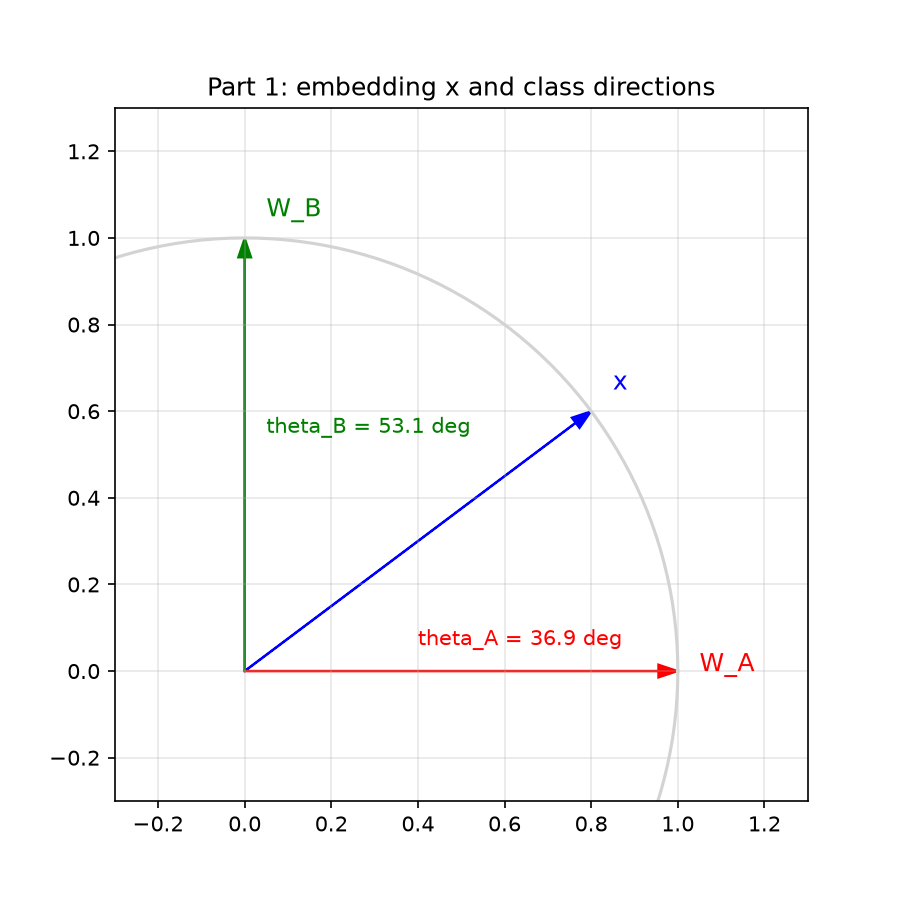
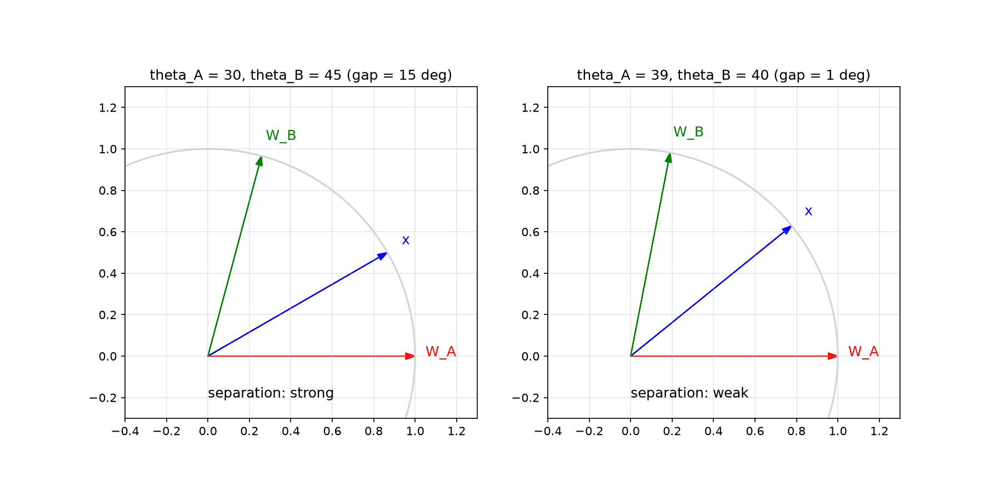
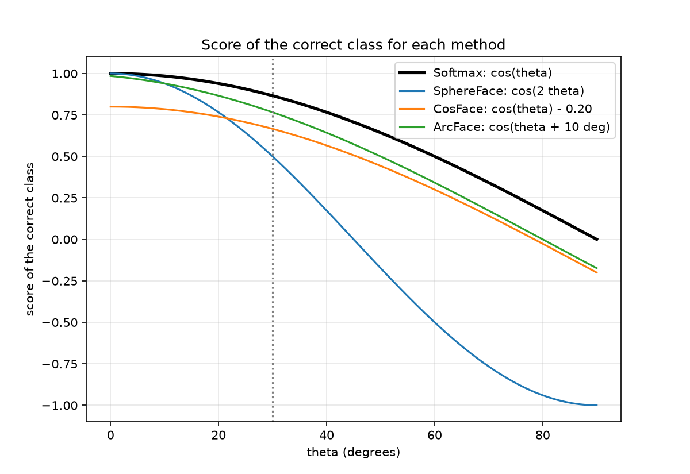
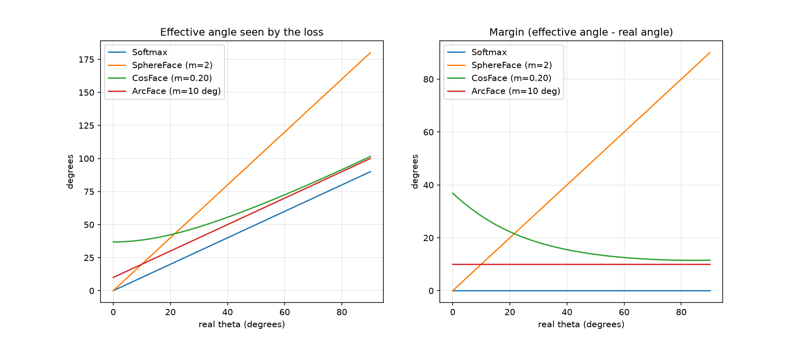
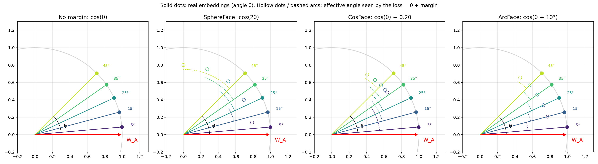

# Understanding SphereFace, CosFace and ArcFace

An assignment that explains how **SphereFace**, **CosFace** and **ArcFace** improve class separation in face recognition, with Python code and plots for each part.

## Objective

Understand how margin-based losses create a more discriminative embedding space. The assignment focuses on three key concepts:

- the **embedding vector**
- the **class direction**
- the **angle and margin** between them

At the end, you should be able to explain clearly what *margin* means and how it differs in SphereFace, CosFace and ArcFace.

---

## Project structure

```
face_margins/
├── main.py                 # choose which part to run
├── part1_embedding.py      # Parts 1-2: 2D embedding space and angular decision
├── part2_margins.py        # Parts 3-6: SphereFace / CosFace / ArcFace and comparison
├── part3_unit_circle.py    # Part 7: unit-circle visual experiment
├── part8_answers.txt       # Part 8: short interpretation answers
├── README.md
└── plots/                  # created automatically
    ├── part1/
    ├── part2/
    └── part3/
```

## Requirements

- Python 3.8+
- `numpy`
- `matplotlib`

```bash
pip install numpy matplotlib
```

## How to run

```bash
python main.py          # interactive menu
python main.py 1        # run part 1 only
python main.py 2        # run part 2 only
python main.py 3        # run part 3 only
python main.py all      # run everything
```

Figures are saved in `plots/part1`, `plots/part2` and `plots/part3`.

---

# The assignment

## Part 1. A simple 2D embedding space

Embedding and class directions:

```
x   = (0.8, 0.6)
W_A = (1, 0)      -> Person A
W_B = (0, 1)      -> Person B
```

**Questions:** plot the vectors, compute the norm of x, verify the three vectors are unit vectors, compute cos(theta_A) and cos(theta_B), convert the angles to degrees, and decide which class the embedding belongs to.

**Answers**

| Quantity | Result |
|---|---|
| norm of x | 1 |
| norm of W_A, W_B | 1, 1 (all unit vectors) |
| cos(theta_A) = x^T W_A | 0.8 |
| cos(theta_B) = x^T W_B | 0.6 |
| theta_A | 36.87° |
| theta_B | 53.13° |

The embedding is assigned to **Class A**, because its angle to W_A is smaller.



## Part 2. Understanding the angular decision

**Case 1:** theta_A = 30°, theta_B = 45°. Class A is closer. A smaller angle means the two vectors point in almost the same direction, so they are more similar.

**Case 2:** theta_A = 39°, theta_B = 40°. The embedding still goes to A, but the separation is **weak** (only 1° gap). A little noise could flip the decision.

A margin improves separation because the correct class must win even after a penalty, so the network is forced to pull embeddings closer to their class and away from the others.



## Part 3. SphereFace (multiplicative angular margin)

Instead of `cos(theta)`, SphereFace uses `cos(m * theta)`.
With theta_A = 30° and m = 2:

- cos(30°) = **0.866**
- cos(2 x 30°) = cos(60°) = **0.5**

The score of the correct class drops, so the task is harder. To get back to 0.866 the network would need theta = 15°. The margin is applied **to the angle, by multiplication**.

## Part 4. CosFace (additive cosine margin)

Instead of `cos(theta)`, CosFace uses `cos(theta) - m`.
With theta_A = 30° and m = 0.20:

- cos(30°) = **0.866**
- cos(30°) - 0.20 = **0.666**

The angle is **not** changed (still 30°). Only the score is lowered, so the network must produce a much smaller angle to win. The margin is applied **to the cosine, by subtraction**.

## Part 5. ArcFace (additive angular margin)

Instead of `cos(theta)`, ArcFace uses `cos(theta + m)`.
With theta_A = 30° and m = 10°:

- cos(30°) = **0.866**
- cos(40°) = **0.766**
- effective angle = **40°**

To get the same score as before, the network must produce theta = 20° (10° smaller). The margin is applied **to the angle, by addition**.

## Part 6. Comparing the three approaches

| Method | Original value | Modified value | Margin applied to |
|---|---|---|---|
| Standard Softmax | cos(theta) | cos(theta) | nothing |
| SphereFace | cos(theta) | cos(m x theta) | the angle (multiplicative) |
| CosFace | cos(theta) | cos(theta) - m | the cosine (additive) |
| ArcFace | cos(theta) | cos(theta + m) | the angle (additive) |

- **Multiplicative angular margin:** the angle is scaled. The margin grows with the angle, so it is uneven.
- **Additive cosine margin:** a fixed number is subtracted from the cosine score. The angle is untouched.
- **Additive angular margin:** a fixed angle is added to theta. The margin is the same everywhere on the hypersphere.





## Part 7. Visual experiment in Python

Embeddings of Person A are generated around `W_A = (1, 0)` at 5°, 15°, 25°, 35° and 45° on the unit circle. Four panels show the requirement for no margin, SphereFace (m = 2), CosFace (m = 0.20) and ArcFace (m = 10°). Solid dots are the real embeddings, hollow dots and dashed arcs show the effective angle seen by the loss (theta + margin).

Effective angle seen by the loss:

| theta | SphereFace | CosFace | ArcFace |
|---|---|---|---|
| 5° | 10° | 37.2° | 15° |
| 15° | 30° | 40.0° | 25° |
| 25° | 50° | 45.1° | 35° |
| 35° | 70° | 51.8° | 45° |
| 45° | 90° | 59.5° | 55° |

SphereFace's margin grows with theta, CosFace's shrinks, and ArcFace's stays constant at 10°.



## Part 8. Interpretation

Short answers (the full text is in `part8_answers.txt`).

1. **What does the angle represent?** How similar the face is to that identity. Small angle = similar.
2. **Why a small angle for the same person?** So all photos of one person stay close together, even with changes in light, pose or expression.
3. **Why separate different identities?** So the system does not mix people up, even similar-looking ones or noisy photos.
4. **Purpose of the margin?** It makes training harder on purpose, forcing embeddings closer to their own class and farther from the others.
5. **Transformations:**
   - SphereFace: `cos(m x theta)`
   - CosFace: `cos(theta) - m`
   - ArcFace: `cos(theta + m)`
6. **Main difference:** SphereFace multiplies the angle, CosFace subtracts from the cosine, ArcFace adds to the angle. ArcFace's margin is a constant angle, which makes it the easiest to interpret.

---

## Conclusion

All three methods introduce a margin during training to create a more discriminative embedding space:

| Method | Transformation |
|---|---|
| SphereFace | `cos(m x theta)` |
| CosFace | `cos(theta) - m` |
| ArcFace | `cos(theta + m)` |

The key idea is not only to classify a face correctly, but also to force its embedding to be closer to the correct class direction and better separated from other identities.

## References

- Liu et al., *SphereFace: Deep Hypersphere Embedding for Face Recognition*, CVPR 2017
- Wang et al., *CosFace: Large Margin Cosine Loss for Deep Face Recognition*, CVPR 2018
- Deng et al., *ArcFace: Additive Angular Margin Loss for Deep Face Recognition*, CVPR 2019
